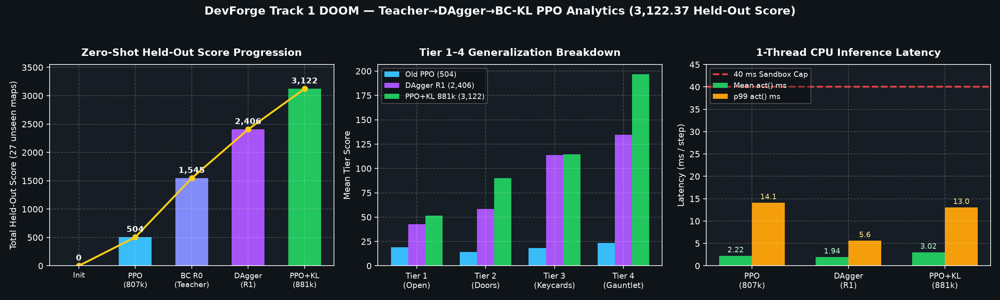

# Can It Play DOOM? — DevForge × Scaler Hackathon 2026 (Track 1: Deep RL)

> **Zero-shot DOOM agent that self-evolves on procedurally generated maps — no hardcoded world coordinates, no memorized button sequences.**

This repository contains our Track 1 Deep RL submission for **DevForge × Scaler Hackathon 2026**. Our agent learns to play unseen DOOM levels zero-shot: navigating multi-room layouts, finding keycards, unlocking doors, surviving combat, and reaching the exit.

---

## Key Highlights

- **Ego-centric perception** — 64-ray depth/hit-type raycasts, entity vitals, yaw-delta odometry, and a coordinate-free 32×32 local occupancy grid (world XYZ never enters the network).
- **HybridDoomNet (Actor-Critic)** — circular 1-D Conv ray encoder, vitals encoder, 256-d GRU temporal core, 4 × 8-d Objective Memory Slots, an **8-sector Value Compass** auxiliary head, and a 9-action MultiBinary policy head with legal action masking.
- **Self-evolving training loop** — Recurrent PPO + GAE + BPTT with RND curiosity, grid novelty bonus, optional BC-KL warmstart, and **Prioritized Level Replay (PLR)** over a 4-tier procedural UDMF map generator.
- **LLM Curriculum Coach** — queries CreoAI (`@cf/openai/gpt-oss-120b`) to adapt difficulty knobs online from live training metrics, with deterministic offline fallback when `CREO_API_KEY` is unset.
- **Strict evaluation envelope** — ≤ 2 GB VRAM, ≤ 8 GB RAM, 1 CPU thread (`torch.set_num_threads(1)`), and ≤ 40 ms/step verified via `validate.py`.

---

## Installation

### Recommended (`uv` + Python 3.13)

This repository pins exact dependencies in `pyproject.toml` and `uv.lock`:

```bash
uv sync
```

### Standard `pip` (if not using `uv`)

```bash
pip install -e env/
pip install -r submission/requirements.txt
# Or if using a root requirements.txt:
pip install -r requirements.txt
```

> **Platform support:** Linux (x86-64/ARM), macOS on Apple Silicon (macOS 15+), and Windows (x86-64) work natively with `uv sync` and `validate.py`. For the closest match to the Linux evaluation sandbox, use Docker:
>
> ```bash
> docker build -t devforge-doom .
> python validate.py --docker --image devforge-doom
> ```

---

## Usage

### Train

Run the self-evolving PPO curriculum trainer (with optional live CreoAI LLM Coach & resume):

```bash
# Offline smoke test (no API key required)
CREO_API_KEY="" uv run python -m training.ppo \
  --config training/configs/ppo_curriculum.yaml \
  --max-steps 500

# Full training with live CreoAI LLM Curriculum Coach
CREO_API_KEY="<your-key>" uv run python -m training.ppo \
  --config training/configs/ppo_curriculum.yaml \
  --use-llm-coach \
  --coach-interval 25 \
  --best-out submission/weights/best_agent.pt

# Resume from an existing checkpoint
uv run python -m training.ppo \
  --config training/configs/ppo_curriculum.yaml \
  --resume runs/ppo_flagship/checkpoints/latest.pt \
  --use-llm-coach
```

Supported CLI overrides include `--max-steps`, `--total-updates`, `--num-envs`, `--output-dir`, `--best-out`, `--resume`, `--device`, `--save-interval`, `--coach-interval`, and `--use-llm-coach`.

### Score on Held-Out Suite & Live Spectator

```bash
# Evaluate a checkpoint on the 27-map held-out benchmark suite
uv run python -m training.scorer.score_checkpoint \
  --checkpoint submission/weights/best_agent.pt \
  --suite training/scorer/eval_suite.json \
  --out eval_results_baseline.json \
  --device cpu

# Watch the agent live (RGB + 32×32 ego-centric occupancy grid + 64-ray radar)
uv run python training/visualize_obs.py --checkpoint submission/weights/best_agent.pt --watch --random-maps
```

> **Current Submitted Checkpoint (`881k` steps — Teacher→DAgger→BC-KL PPO):** **`3,122.37`** total score on 27 unseen held-out maps (`22.2%` zero-shot exit rate, Tier 1–4: `51.7 / 90.2 / 114.7 / 196.9`, `3.02 ms` mean `act()`, `13.03 ms` p99, `validate.py` **PASSED**).
>
> 

### Validate

Verify the submission contract, single-thread latency budget (≤ 40 ms/step), and memory limits:

```bash
uv run python validate.py
# Or:
python validate.py
```

### Verify Submission Entrypoint

Check that the evaluation agent imports cleanly:

```bash
uv run python -c "from submission.agent import DoomAgent; print('OK')"
# Or:
python -c "from submission.agent import DoomAgent; print('OK')"
```

### Run Tests

```bash
uv run pytest
```

---

## Held-Out Benchmark & Validation Results

Evaluated on [training/scorer/eval_suite.json](training/scorer/eval_suite.json) (24 disjoint procedural WADs + 3 `freedoom2.wad` maps) and verified with `validate.py` (see [eval_results_baseline.json](eval_results_baseline.json)):

| Metric | Value (`best_agent.pt`, 77.8k steps) |
| --- | --- |
| Held-out Total Score | **344.28** (`Tier 1–4 avg: 19.0 / 6.2 / 11.7 / 15.0`) |
| Held-out Exit Rate | **3.7%** |
| Scorer Latency (1 CPU thread) | **3.28 ms** mean / **18.74 ms** p99 *(budget: 40 ms)* |
| `validate.py` Status | **PASSED** (`p50: 2.0 ms`, `p99: 7.5 ms`, repo `8.5 MB / 1.0 GB`) |

---

## Module Layout

```text
env/                      # doom_env — official ViZDoom Gymnasium wrapper (spaces, sensors, limits)
training/                 # Deep RL training pipeline
  ├── configs/            # YAML configs (ppo_curriculum.yaml, bc.yaml, eval.yaml)
  ├── mapgen/             # 4-tier procedural UDMF map generator & verifier
  ├── bc/                 # Optional behavioural cloning warmstart
  ├── scorer/             # Heldout evaluation suite, checkpoint scorer, replay renderer
  ├── model.py            # HybridDoomNet (RayCircularEncoder, GRU, ObjectiveSlots, Value Compass)
  ├── preprocessing.py    # Ego-centric preprocessing, ActionMask, ModelInputs
  ├── odometry_grid.py    # Coordinate-free scan-matched occupancy grid
  ├── rewards.py          # Coordinate-free sector-based reward shaper
  ├── curriculum_plr.py   # Prioritized Level Replay (PLR) buffer
  ├── envs.py             # VecDoomEnv multiprocessing wrapper
  ├── rnd.py              # Random Network Distillation curiosity + grid novelty
  ├── llm_coach.py        # CreoAI curriculum coach with deterministic offline fallback
  └── ppo.py              # Recurrent PPO + GAE + BPTT training entrypoint
submission/
  ├── agent.py            # DoomAgent evaluation entrypoint (act / reset, 1-thread guard)
  ├── requirements.txt    # Extra pinned pip packages for the evaluation container
  └── weights/            # Trained weights tracked via Git LFS (best_agent.pt)
tests/                    # Unit, integration, and E2E test suite
maps/                     # Test map (two_rooms.wad) + 32 heldout evaluation WADs (maps/heldout/)
docs/                     # Official contract, rules, submission guide, evaluation spec
planning/                 # Architecture design, frozen schemas, PRD, and team runbooks
validate.py               # Pre-submission validator (contract, latency, RAM/VRAM)
PROJECT_BRIEF.md          # 2-page project brief
```

---

## Documentation & Rules

| Doc | Contents |
| --- | --- |
| [PROJECT_BRIEF.pdf](PROJECT_BRIEF.pdf) | Final 2-page Project Brief PDF for submission |
| [docs/PROJECT_BRIEF.md](docs/PROJECT_BRIEF.md) | 2-page architecture overview, benchmarks, and rule compliance |
| [eval_results_baseline.json](eval_results_baseline.json) | Held-out evaluation scorecard for `submission/weights/best_agent.pt` |
| [docs/CONTRACT.md](docs/CONTRACT.md) | Observation/action spaces and `DoomAgent` interface |
| [docs/RULES.md](docs/RULES.md) | Ground rules and disqualifiers (no hardcoded XYZ, no rule trees / A* / aimbots) |
| [docs/SUBMISSION.md](docs/SUBMISSION.md) | Submission checklist, Git LFS, 1 GB limit, `requirements.txt` |
| [docs/EVALUATION.md](docs/EVALUATION.md) | Map tiers, scoring categories, hardware envelope, timeouts |

---

## Team

- **Team Member 1 (RL Engineer)** — RL / PPO (`envs.py`, `ppo.py`, `rnd.py`, `llm_coach.py`, `bc/`)
- **Team Member 2 (Neural Architecture Engineer)** — Model / Scorer (`model.py`, `preprocessing.py`, `odometry_grid.py`, `submission/agent.py`, `scorer/`)
- **Team Member 3 (Environment Engineer)** — MapGen / Rewards (`mapgen/`, `rewards.py`, `curriculum_plr.py`)
- **Team Member 4 (Training & QA Engineer)** — Training / Docs (smoke testing, training runs, `README.md`, documentation)
