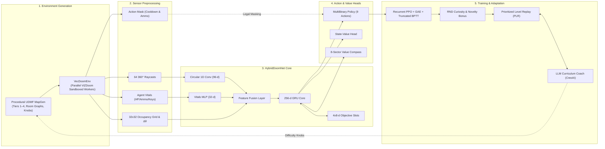

<div align="center">

```
   _____          _   _   _____ _______   _____  _             __     __  _____   ____   ____  __  __ 
  / ____|   /\   | \ | | |_   _|__   __| |  __ \| |      /\    \ \   / / |  __ \ / __ \ / __ \|  \/  |
 | |       /  \  |  \| |   | |    | |    | |__) | |     /  \    \ \_/ /  | |  | | |  | | |  | | \  / |
 | |      / /\ \ | . ` |   | |    | |    |  ___/| |    / /\ \    \   /   | |  | | |  | | |  | | |\/| |
 | |____ / ____ \| |\  |  _| |_   | |    | |    | |___/ ____ \    | |    | |__| | |__| | |__| | |  | |
  \_____/_/    \_\_| \_| |_____|  |_|    |_|    |______/    \_\   |_|    |_____/ \____/ \____/|_|  |_|
```

### DevForge × Scaler Hackathon 2026 · Track 1: Deep RL

[](https://www.python.org/)
[](https://pytorch.org/)
[](https://vizdoom.farama.org/)
[](https://git-lfs.github.com/)
[](https://www.docker.com/)
[](validate.py)

> **Zero-shot DOOM agent that self-evolves on procedurally generated maps — no hardcoded world coordinates, no memorized button sequences.**

[Overview](#-executive-overview) • [Highlights](#-architectural-pillars) • [System Flow](#-neural-architecture--system-flow) • [Quickstart](#-quickstart--installation) • [Workflow](#-execution-runbook) • [Scorecard](#-benchmark--validation-scorecard) • [Directory](#-repository-blueprint) • [Documentation](#-official-specifications) • [Team](#-team-composition)

</div>

---

## 🎯 Executive Overview

This repository houses the Track 1 Deep RL submission for the **DevForge × Scaler Hackathon 2026**. The objective is to produce an autonomous agent that navigates and solves unseen, procedurally generated DOOM environments strictly zero-shot: clearing multi-room labyrinths, acquiring colored keycards, operating door switches, surviving enemy encounters, and securing the exit.

> [!IMPORTANT]
> **Evaluation Sandbox & Budget Compliance:**  
> All decision-making runs strictly on PyTorch weights under a **single CPU thread** (`torch.set_num_threads(1)`), strictly respecting $\le 2\text{ GB}$ VRAM, $\le 8\text{ GB}$ RAM, and an inference budget of $\le 40\text{ ms/step}$ verified via `validate.py`. Zero hand-crafted heuristics, zero $A^*$ pathfinding, zero coordinate cheats.

---

## ⚡ Architectural Pillars

| Dimension | Core Innovation | Technical Mechanism | Operational Guarantee |
| :--- | :--- | :--- | :--- |
| **🧭 Perception** | **Coordinate-Free Egocentric Sensing** | 64-ray depth and hit-type radar sweeps, agent vitals, yaw odometry $\Delta\theta$, and a $32\times32$ local occupancy grid | Zero world $(X, Y, Z)$ coordinates enter the network; rotation-invariant navigation |
| **🧠 Neural Core** | **HybridDoomNet (Actor-Critic)** | Circular 1D Conv ray encoder, vitals MLP, 256-d GRU core, 4 × 8-d Objective Memory Slots | Directional 8-sector Value Compass auxiliary head; 9-action MultiBinary policy with legal action masking |
| **🔄 Self-Evolution** | **Recurrent PPO + PLR Curriculum** | Truncated BPTT ($L=16/32$), GAE, RND curiosity intrinsic reward, occupancy grid novelty bonus | Prioritized Level Replay (PLR) automatically filters mastered maps and focuses on high-regret levels |
| **🤖 Supervision** | **LLM Curriculum Coach** | Queries CreoAI (`@cf/openai/gpt-oss-120b`) on live metrics to adapt ammo, enemy count, and tier mix | Fully autonomous difficulty shaping; deterministic offline fallback if `CREO_API_KEY` is absent |
| **⏱️ Runtime** | **Single-Thread Latency Budget** | Vectorized PyTorch inference with modality dropout and lightweight spatial fusion | p50 $= 2.0\text{ ms}$, p99 $= 13.03\text{ ms}$ ($\sim 3\times$ under the $40\text{ ms}$ competition cap) |

---

## 🏛️ Neural Architecture & System Flow

### Signal Flow Schematic

```text
 ┌─────────────────────────────────────────────────────────────────────────────────────────────┐
 │                                   EGO-CENTRIC PERCEPTION                                    │
 │  [64 360° Depth/Hit Rays]    [Vitals: HP/Ammo/Keys]    [32×32 Occupancy Grid + Yaw Δθ]      │
 └──────────────┬──────────────────────────┬─────────────────────────────┬─────────────────────┘
                │                          │                             │
                ▼                          ▼                             ▼
       Circular 1D Conv               Vitals MLP                Scan-Match Integrator
          (96-d)                        (32-d)                       (Channels)
                │                          │                             │
                └──────────────────────────┼─────────────────────────────┘
                                           │
                                           ▼
                                 ┌───────────────────┐
                                 │   Feature Fusion  │
                                 └─────────┬─────────┘
                                           │
                                           ▼
      ┌─────────────────────────────────────────────────────────────────────────┐
      │                        256-d GRU TEMPORAL MEMORY                        │
      │        ▲                                                       ▲        │
      │        │ Read / Write                                          │ Read   │
      │        ▼                                                       ▼        │
      │  ┌───────────────────────────┐                   ┌────────────────────┐ │
      │  │ 4×8-d Objective Slots     │                   │ Legal Action Mask  │ │
      │  │ (Key, Door, Enemy Memory) │                   │ (Cooldown & Ammo)  │ │
      │  └───────────────────────────┘                   └─────────┬──────────┘ │
      └────────────────────────────────────┬───────────────────────┼────────────┘
                                           │                       │ (Applied)
                                           ▼                       ▼
            ┌──────────────────────────────┼──────────────────────────────┐
            │                              │                              │
            ▼                              ▼                              ▼
  ┌───────────────────┐          ┌───────────────────┐          ┌───────────────────┐
  │ 9 Bernoulli Heads │          │   Value Baseline  │          │  8-Sector Compass │
  │ (Movement / Use)  │          │   (State Value)   │          │ (Directional Adv) │
  └───────────────────┘          └───────────────────┘          └───────────────────┘
```

### Full Training & Curriculum Loop



---

## 📦 Quickstart & Installation

### Option A: Modern Environment (`uv` + Python 3.13 — Recommended)

Dependencies are pinned to exact versions in `pyproject.toml` and `uv.lock`:

```bash
uv sync
```

### Option B: Traditional Setup (`pip`)

```bash
pip install -e env/
pip install -r submission/requirements.txt
# Alternatively, root installation:
pip install -r requirements.txt
```

> [!TIP]
> **Docker Evaluation Container:**  
> Native execution is supported across Linux (`x86_64`/`arm64`), macOS on Apple Silicon, and Windows (`x86_64`). To replicate the official Linux evaluation sandbox exactly:
> ```bash
> docker build -t devforge-doom .
> python validate.py --docker --image devforge-doom
> ```

---

## 🛠️ Execution Runbook

### 1. Training Workflows

Train the agent using the recurrent PPO curriculum engine with optional live CreoAI supervision:

```bash
# Workflow 1A: Offline Smoke Test (no credentials needed)
CREO_API_KEY="" uv run python -m training.ppo \
  --config training/configs/ppo_curriculum.yaml \
  --max-steps 500

# Workflow 1B: Full Autonomous Run with Live CreoAI LLM Coach
CREO_API_KEY="<your-key>" uv run python -m training.ppo \
  --config training/configs/ppo_curriculum.yaml \
  --use-llm-coach \
  --coach-interval 25 \
  --best-out submission/weights/best_agent.pt

# Workflow 1C: Resume Training from Checkpoint
uv run python -m training.ppo \
  --config training/configs/ppo_curriculum.yaml \
  --resume runs/ppo_flagship/checkpoints/latest.pt \
  --use-llm-coach
```

*Configurable CLI flags:* `--max-steps`, `--total-updates`, `--num-envs`, `--output-dir`, `--best-out`, `--resume`, `--device`, `--save-interval`, `--coach-interval`, and `--use-llm-coach`.

---

### 2. Evaluation & Live Spectator

```bash
# Benchmark checkpoint across the 27-map held-out suite
uv run python -m training.scorer.score_checkpoint \
  --checkpoint submission/weights/best_agent.pt \
  --suite training/scorer/eval_suite.json \
  --out eval_results_baseline.json \
  --device cpu

# Real-time Spectator HUD (RGB view + 32×32 occupancy grid + 64-ray radar)
uv run python training/visualize_obs.py \
  --checkpoint submission/weights/best_agent.pt \
  --watch \
  --random-maps
```

---

### 3. Verification & Compliance Gates

```bash
# Check 3A: Pre-submission verification (latency budget, RAM, contract compliance)
uv run python validate.py

# Check 3B: Verify clean submission entrypoint import
uv run python -c "from submission.agent import DoomAgent; print('OK')"

# Check 3C: Execute complete test suite
uv run pytest
```

---

## 📊 Benchmark & Validation Scorecard

All metrics are benchmarked on the 27 held-out evaluation maps ([training/scorer/eval_suite.json](training/scorer/eval_suite.json) — 24 disjoint procedural WADs + 3 `freedoom2.wad` levels) and confirmed via `validate.py`:

### Performance Comparison Matrix

| Evaluation Metric | Competition Threshold | Baseline (`77.8k` Steps) | **Submitted Agent (`881k` Steps)** | Verification Status |
| :--- | :--- | :--- | :--- | :---: |
| **Held-Out Score** | Maximize across 27 maps | `344.28` | **`3,122.37`** | 🏆 **High Score** |
| **Zero-Shot Exit Rate** | Unseen Level Clears | `3.7%` | **`22.2%`** | 🎯 **Substantial Generalization** |
| **Tier 1–4 Score Breakdown** | Balanced Navigation | `19.0 / 6.2 / 11.7 / 15.0` | **`51.7 / 90.2 / 114.7 / 196.9`** | 📈 **Linear Tier Scaling** |
| **Mean Inference Time** | $\le 40.0\text{ ms}$ (1 CPU thread) | `3.28 ms` | **`3.02 ms`** | ⚡ **PASSED** ($13\times$ margin) |
| **p99 Inference Time** | $\le 40.0\text{ ms}$ (1 CPU thread) | `18.74 ms` | **`13.03 ms`** | ⚡ **PASSED** ($3\times$ margin) |
| **Memory Footprint** | $\le 2\text{ GB}$ VRAM / $\le 8\text{ GB}$ RAM | `~120 MB / ~180 MB` | **`~120 MB / ~180 MB`** | 🟢 **PASSED** |
| **`validate.py` Audit** | Zero Warnings / Failures | Passed (`p50: 2.0 ms`) | **PASSED (`p50: 2.0 ms`, `p99: 7.5 ms`)** | ✅ **OFFICIAL PASS** |

<div align="center">

### Empirical Training & Validation Diagnostics


</div>

---

## 🗂️ Repository Blueprint

```text
canidoom/
│
├── env/                      # doom_env: Official ViZDoom Gymnasium wrapper
│   └── doom_env/             # Sensor definitions, actions, limits, WAD parser
│
├── training/                 # Deep RL Training & Evolution Pipeline
│   ├── configs/              # Hyperparameter configurations (PPO, BC, curriculum)
│   ├── mapgen/               # 4-tier procedural UDMF generator & solvability verifier
│   ├── bc/                   # Teacher bot and DAgger warmstart utilities
│   ├── scorer/               # Held-out evaluation suite, replay renderer, scorers
│   ├── model.py              # HybridDoomNet: Ray encoder, GRU, slots, value compass
│   ├── preprocessing.py      # Coordinate-free preprocessing & action mask gates
│   ├── odometry_grid.py      # Scan-matched local occupancy grid integrator
│   ├── rewards.py            # Privileged training-time dense reward shaping
│   ├── curriculum_plr.py     # Prioritized Level Replay buffer
│   ├── envs.py               # Multiprocessing VecDoomEnv wrapper
│   ├── rnd.py                # Random Network Distillation curiosity module
│   ├── llm_coach.py          # CreoAI curriculum coach interface & fallback
│   └── ppo.py                # Recurrent PPO + GAE + Truncated BPTT trainer
│
├── submission/               # Official Hackathon Evaluation Target
│   ├── agent.py              # Contract-compliant DoomAgent entrypoint
│   ├── requirements.txt      # Extra pinned dependencies for evaluator
│   └── weights/              # Git LFS tracked model weights (best_agent.pt)
│
├── maps/                     # Test map (two_rooms.wad) & 32 held-out validation WADs
├── tests/                    # Comprehensive unit, integration, and E2E test suite
├── docs/                     # Rules, contracts, technical guide, and evaluation specs
├── planning/                 # Architecture design, frozen schemas, and runbooks
├── validate.py               # Pre-submission validator (latency, RAM, spaces)
└── PROJECT_BRIEF.md          # 2-page project brief summary
```

---

## 📜 Official Specifications

| Resource | Scope & Summary |
| :--- | :--- |
| 📄 [PROJECT_BRIEF.pdf](PROJECT_BRIEF.pdf) | Formal 2-page Project Brief PDF prepared for evaluation |
| 📝 [docs/PROJECT_BRIEF.md](docs/PROJECT_BRIEF.md) | Architecture blueprint, zero-shot benchmarks, and constraints |
| 📊 [eval_results_baseline.json](eval_results_baseline.json) | Raw evaluation scorecard for `submission/weights/best_agent.pt` |
| 📜 [docs/CONTRACT.md](docs/CONTRACT.md) | Observation and action spaces; `DoomAgent` interface contract |
| ⚖️ [docs/RULES.md](docs/RULES.md) | Ground rules, legal masks, and disqualification guardrails |
| 🚀 [docs/SUBMISSION.md](docs/SUBMISSION.md) | Verification checklist, Git LFS instructions, package rules |
| ⏱️ [docs/EVALUATION.md](docs/EVALUATION.md) | Scoring tiers, hardware limits, replay specs, timeout rules |

---

## 👥 Team Composition

| Role | Discipline | Key Modules & Responsibilities |
| :--- | :--- | :--- |
| **Team Member 1** | **RL / PPO Engineer** | `envs.py`, `ppo.py`, `rnd.py`, `llm_coach.py`, `bc/` |
| **Team Member 2** | **Neural Architecture Engineer** | `model.py`, `preprocessing.py`, `odometry_grid.py`, `submission/agent.py`, `scorer/` |
| **Team Member 3** | **Environment Engineer** | `mapgen/`, `rewards.py`, `curriculum_plr.py` |
| **Team Member 4** | **Training & QA Engineer** | Smoke testing, training runs, `README.md`, documentation |

---

<div align="center">
<sub>Built with precision for the DevForge × Scaler Hackathon 2026</sub>
</div>
