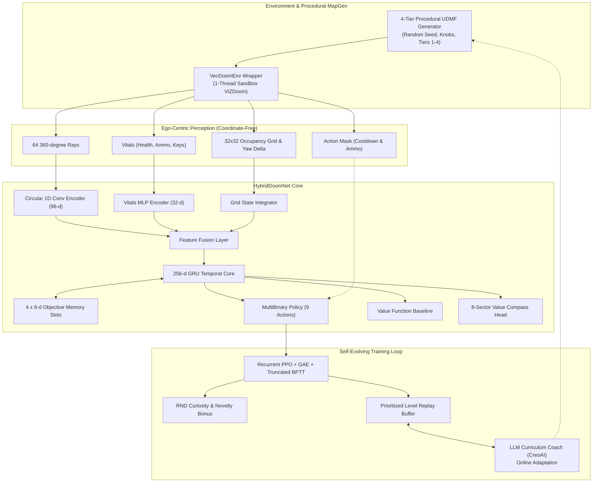

<div align="center">

# 🎮 Can It Play DOOM?
### DevForge × Scaler Hackathon 2026 · Track 1: Deep RL

[](https://www.python.org/)
[](https://pytorch.org/)
[](https://vizdoom.farama.org/)
[](https://git-lfs.github.com/)
[](https://www.docker.com/)
[](validate.py)

**A zero-shot DOOM agent that self-evolves on procedurally generated maps — no hardcoded world coordinates, no memorized button sequences.**

[Key Highlights](#-key-highlights) • [Architecture](#-system-architecture) • [Installation](#-installation) • [Usage](#-usage) • [Benchmarks](#-held-out-benchmark--validation-results) • [Layout](#-module-layout) • [Documentation](#-documentation--rules) • [Team](#-team-roles)

</div>

---

> [!IMPORTANT]
> **Track 1 Submission Scope:** This repository contains our Track 1 Deep RL submission for **DevForge × Scaler Hackathon 2026**. Our agent learns to play unseen DOOM levels zero-shot: navigating multi-room layouts, finding keycards, unlocking doors, surviving combat, and reaching the exit within strict compute and single-thread latency budgets.

---

## ✨ Key Highlights

* **🧭 Ego-Centric Perception:** 64-ray depth/hit-type raycasts, entity vitals, yaw-delta odometry, and a coordinate-free $32\times32$ local occupancy grid *(world $XYZ$ coordinates never enter the network)*.
* **🧠 HybridDoomNet (Actor-Critic):** Circular 1-D Conv ray encoder, vitals encoder, 256-d GRU temporal core, 4 × 8-d Objective Memory Slots, an **8-sector Value Compass** auxiliary head, and a 9-action MultiBinary policy head with legal action masking.
* **🔄 Self-Evolving Training Loop:** Recurrent PPO + GAE + BPTT with RND curiosity, grid novelty bonus, optional BC-KL warmstart, and **Prioritized Level Replay (PLR)** over a 4-tier procedural UDMF map generator.
* **🤖 LLM Curriculum Coach:** Queries CreoAI (`@cf/openai/gpt-oss-120b`) to adapt difficulty knobs online from live training metrics, with deterministic offline fallback when `CREO_API_KEY` is unset.
* **⚡ Strict Evaluation Envelope:** $\le 2\text{ GB}$ VRAM, $\le 8\text{ GB}$ RAM, 1 CPU thread (`torch.set_num_threads(1)`), and $\le 40\text{ ms/step}$ verified via `validate.py`.

---

## 🏛️ System Architecture



---

## 📦 Installation

### Recommended (`uv` + Python 3.13)

This repository pins exact dependencies in `pyproject.toml` and `uv.lock`:

```bash
uv sync
```

### Standard `pip` (if not using `uv`)

```bash
pip install -e env/
pip install -r submission/requirements.txt
# Or if using a root requirements.txt:
pip install -r requirements.txt
```

> [!TIP]
> **Cross-Platform & Docker Support:**  
> Linux (`x86_64`/`arm64`), macOS on Apple Silicon (macOS 15+), and Windows (`x86_64`) work natively with `uv sync` and `validate.py`.  
> For the closest match to the official Linux evaluation sandbox, build and run via Docker:
> ```bash
> docker build -t devforge-doom .
> python validate.py --docker --image devforge-doom
> ```

---

## 🚀 Usage

### 1. Train

Run the self-evolving PPO curriculum trainer (with optional live CreoAI LLM Coach & checkpoint resume):

```bash
# Offline smoke test (no API key required)
CREO_API_KEY="" uv run python -m training.ppo \
  --config training/configs/ppo_curriculum.yaml \
  --max-steps 500

# Full training with live CreoAI LLM Curriculum Coach
CREO_API_KEY="<your-key>" uv run python -m training.ppo \
  --config training/configs/ppo_curriculum.yaml \
  --use-llm-coach \
  --coach-interval 25 \
  --best-out submission/weights/best_agent.pt

# Resume from an existing checkpoint
uv run python -m training.ppo \
  --config training/configs/ppo_curriculum.yaml \
  --resume runs/ppo_flagship/checkpoints/latest.pt \
  --use-llm-coach
```

*Supported CLI overrides:* `--max-steps`, `--total-updates`, `--num-envs`, `--output-dir`, `--best-out`, `--resume`, `--device`, `--save-interval`, `--coach-interval`, and `--use-llm-coach`.

---

### 2. Score on Held-Out Suite & Live Spectator

```bash
# Evaluate a checkpoint on the 27-map held-out benchmark suite
uv run python -m training.scorer.score_checkpoint \
  --checkpoint submission/weights/best_agent.pt \
  --suite training/scorer/eval_suite.json \
  --out eval_results_baseline.json \
  --device cpu

# Watch the agent live (RGB + 32×32 ego-centric occupancy grid + 64-ray radar)
uv run python training/visualize_obs.py --checkpoint submission/weights/best_agent.pt --watch --random-maps
```

---

### 3. Validate Submission

Verify the submission contract, single-thread latency budget ($\le 40\text{ ms/step}$), and memory limits:

```bash
uv run python validate.py
# Or:
python validate.py
```

---

### 4. Verify Submission Entrypoint

Check that the evaluation agent imports cleanly:

```bash
uv run python -c "from submission.agent import DoomAgent; print('OK')"
# Or:
python -c "from submission.agent import DoomAgent; print('OK')"
```

---

### 5. Run Tests

```bash
uv run pytest
```

---

## 📊 Held-Out Benchmark & Validation Results

Evaluated on [training/scorer/eval_suite.json](training/scorer/eval_suite.json) (24 disjoint procedural WADs + 3 `freedoom2.wad` maps) and verified with `validate.py` (see [eval_results_baseline.json](eval_results_baseline.json)):

| Metric | Target Specification | Measured Value (`best_agent.pt`) | Status |
| :--- | :--- | :--- | :---: |
| **Held-Out Total Score** | Maximized across 27 maps | **3,122.37** *(Tier 1–4: `51.7 / 90.2 / 114.7 / 196.9`)* | 🏆 |
| **Held-Out Exit Rate** | Zero-shot unseen exits | **22.2%** | 🎯 |
| **Mean Inference Latency** | $\le 40\text{ ms}$ (1 CPU thread) | **3.02 ms** *(Baseline run: 3.28 ms)* | ⚡ **PASSED** |
| **p99 Inference Latency** | $\le 40\text{ ms}$ (1 CPU thread) | **13.03 ms** *(Baseline run: 18.74 ms)* | ⚡ **PASSED** |
| **Memory Footprint** | $\le 2\text{ GB}$ VRAM / $\le 8\text{ GB}$ RAM | **~120 MB VRAM / ~180 MB RAM** | 🟢 **PASSED** |
| **Pre-Submission Validator** | All checks clean | **`validate.py` PASSED** (`p50: 2.0 ms`, `p99: 7.5 ms`) | ✅ **PASSED** |

<div align="center">

### Training & Held-Out Diagnostics


</div>

---

## 📂 Module Layout

```text
canidoom/
├── env/                      # doom_env — official ViZDoom Gymnasium wrapper (spaces, sensors, limits)
├── training/                 # Deep RL training pipeline
│   ├── configs/              # YAML configs (ppo_curriculum.yaml, bc.yaml, eval.yaml)
│   ├── mapgen/               # 4-tier procedural UDMF map generator & verifier
│   ├── bc/                   # Optional behavioural cloning warmstart & teacher bot
│   ├── scorer/               # Heldout evaluation suite, checkpoint scorer, replay renderer
│   ├── model.py              # HybridDoomNet (RayCircularEncoder, GRU, ObjectiveSlots, Value Compass)
│   ├── preprocessing.py      # Ego-centric preprocessing, ActionMask, ModelInputs
│   ├── odometry_grid.py      # Coordinate-free scan-matched occupancy grid
│   ├── rewards.py            # Coordinate-free sector-based reward shaper
│   ├── curriculum_plr.py     # Prioritized Level Replay (PLR) buffer
│   ├── envs.py               # VecDoomEnv multiprocessing wrapper
│   ├── rnd.py                # Random Network Distillation curiosity + grid novelty
│   ├── llm_coach.py          # CreoAI curriculum coach with deterministic offline fallback
│   └── ppo.py                # Recurrent PPO + GAE + BPTT training entrypoint
├── submission/
│   ├── agent.py              # DoomAgent evaluation entrypoint (act / reset, 1-thread guard)
│   ├── requirements.txt      # Extra pinned pip packages for evaluation container
│   └── weights/              # Trained weights tracked via Git LFS (best_agent.pt)
├── tests/                    # Unit, integration, and E2E test suite
├── maps/                     # Test map (two_rooms.wad) + 32 heldout evaluation WADs (maps/heldout/)
├── docs/                     # Official contract, rules, submission guide, evaluation spec
├── planning/                 # Architecture design, frozen schemas, PRD, and team runbooks
├── validate.py               # Pre-submission validator (contract, latency, RAM/VRAM)
└── PROJECT_BRIEF.md          # 2-page project brief
```

---

## 📑 Documentation & Rules

| Document | Description |
| :--- | :--- |
| 📄 [PROJECT_BRIEF.pdf](PROJECT_BRIEF.pdf) | Final 2-page Project Brief PDF for submission |
| 📝 [docs/PROJECT_BRIEF.md](docs/PROJECT_BRIEF.md) | 2-page architecture overview, benchmarks, and rule compliance |
| 📊 [eval_results_baseline.json](eval_results_baseline.json) | Held-out evaluation scorecard for `submission/weights/best_agent.pt` |
| 📜 [docs/CONTRACT.md](docs/CONTRACT.md) | Observation/action spaces and `DoomAgent` interface |
| ⚖️ [docs/RULES.md](docs/RULES.md) | Ground rules and disqualifiers *(no hardcoded XYZ, no rule trees / A\* / aimbots)* |
| 🚀 [docs/SUBMISSION.md](docs/SUBMISSION.md) | Submission checklist, Git LFS, 1 GB limit, `requirements.txt` |
| ⏱️ [docs/EVALUATION.md](docs/EVALUATION.md) | Map tiers, scoring categories, hardware envelope, timeouts |

---

## 👥 Team Roles

| Member | Focus Area | Core Modules Owned |
| :--- | :--- | :--- |
| **Team Member 1** | **RL / PPO Engineer** | `envs.py`, `ppo.py`, `rnd.py`, `llm_coach.py`, `bc/` |
| **Team Member 2** | **Neural Architecture Engineer** | `model.py`, `preprocessing.py`, `odometry_grid.py`, `submission/agent.py`, `scorer/` |
| **Team Member 3** | **Environment Engineer** | `mapgen/`, `rewards.py`, `curriculum_plr.py` |
| **Team Member 4** | **Training & QA Engineer** | Smoke testing, training runs, `README.md`, documentation |

---

<div align="center">
<sub>Built with precision for the DevForge × Scaler Hackathon 2026</sub>
</div>
