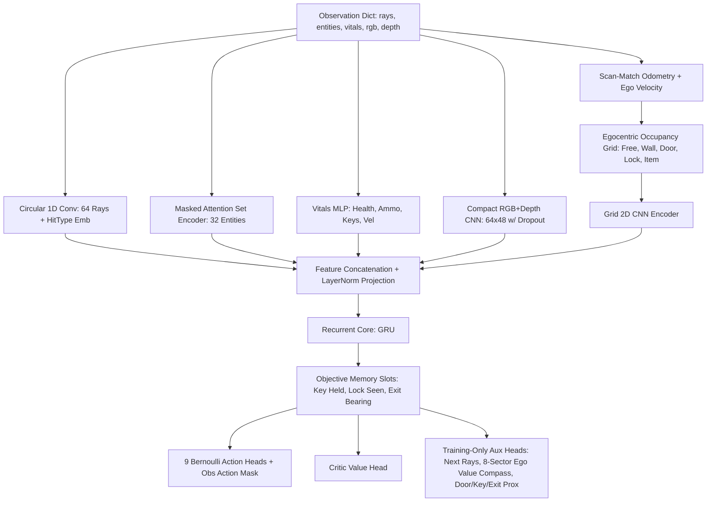
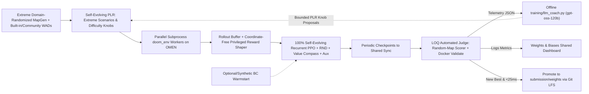

# Yugaantar 2026 · DevForge — Track 1: "Can It Play DOOM?" Game Plan

> **H0 Active Status:** Hackathon H0 is active! Official template `Reinforce-SST/devforge-doom-template` (`63b90c4`) is synced at the repository root (`origin/main`: `https://github.com/aryanbhojgaria/canitdoom.git`), and implementation is in progress per `docs/RULES.md`.

---

## 1. TL;DR & Win Thesis

* **Target Track:** Track 1 (*"Can It Play DOOM?"*), avoiding friend-group overlap on Track 4 and capitalizing on CPU-fast spatial simulation + custom RL architecture.
* **Win Thesis — Partial Progress Wins Stage 1:** The automated leaderboard awards weighted partial progress across 4 unseen tiers (Exit > Progression [keys, doors, locks] > Exploration [unique sectors] > Combat [kills minus damage/early death]). Most teams wrap default pixel PPO (or SB3) and spin in corners; a reliable spatial-memory navigator + fighter clears Tiers 1–2 and unlocks Tier 3 progression points.
* **Win Thesis — Self-Evolving Generalist via Extreme Procedural UDMF Maps:** Hidden maps are procedurally/randomly generated, short-horizon (2,100–4,200 ticks = 60–120 s), and include extreme unseen scenarios (tight claustrophobic ambushes, huge open arenas, multi-branch mazes, scarce-ammo survival, dense monster waves). Training **100% self-evolving RL from scratch** (with **zero fixed XYZ coordinate assumptions** and **zero hardcoding**) on extreme domain-randomized 4-tier procedural UDMF maps turns "infinite unseen layouts" into our core strength.
* **Win Thesis — Ego-Directional Value Compass + RND + Egocentric Grid:** Custom recurrent PPO + RND + Egocentric Occupancy Grid + Objective Slots + an explicit **8-sector Ego-Directional Value / Advantage Compass Auxiliary Head (`value_compass: (B, 8)`)** teaches the agent to judge which ego-centric direction yields positive reward ("plus points") on arbitrary random layouts — without requiring human demos (`train_bc.py` kept strictly optional/synthetic-compatible).
* **Win Thesis — Built for Manual & Replay Review:** The top 4–5 teams have their code and replays manually reviewed, and the top 2 advance to finals. Clean custom PyTorch code, scan-matching egocentric grid memory, held-out local evaluation, and crisp replay demos directly maximize both automated and human scores.

---

## 2. Verified Template & Contract Facts

Verified directly against the official starter template (`Reinforce-SST/devforge-doom-template`: `docs/CONTRACT.md`, `docs/EVALUATION.md`, `docs/RULES.md`, `docs/SUBMISSION.md`, `env/doom_env/spaces.py`, `env/doom_env/limits.py`, `env/doom_env/wrapper.py`).

| Component | Verified Specification | Design Implication |
| :--- | :--- | :--- |
| **Observation: `rgb` & `depth`** | `rgb`: `(120, 160, 3)` `uint8`; `depth`: `(120, 160)` `uint8` (HUD/crosshair/messages disabled) | Downsample `rgb` to `64×48` (and optional depth strip) for a tiny CNN; apply modality dropout so spatial branch carries load if pixels shift. |
| **Observation: `vitals`** | `(17,)` `float32`: `health`, `armor`, `selected_weapon`, `selected_weapon_ammo`, `ammo_bullets/shells/rockets/cells` (0–7), 6 binary key flags (`key_blue/yellow/red_card` & `skull`, 8–13), ego velocities `vel_forward`, `vel_right`, `vel_up` (14–16) | Keys are observed directly once picked up. **No global position or yaw heading/angle is provided.** |
| **Observation: `rays`** | `64` rays over full **360°** (idx `0` straight ahead, CCW, idx `16` = 90° left, idx `32` = behind), `RAY_RANGE = 1024.0`, `distance` normalized `[0, 1]`, `hit_type` in `{0: none, 1: wall, 2: door, 3: locked_door, 4: enemy, 5: item}` | Agent sees 360° around itself without pixels! Consecutive 360° ray scans allow **circular cross-correlation scan-matching** to estimate turn angle `Δθ` for dead-reckoned mapping. |
| **Observation: `visible_entities`** | Up to `MAX_ENTITIES = 32` inside **90° horizontal FOV** & line-of-sight (≤ 4,096 units); `features` `(32, 5)`: `[dist/1024, sin(rel_angle), cos(rel_angle), rel_vel_fwd, rel_vel_right]`; `entity_type` (12 IDs incl. `pad`, `enemy_melee`, `enemy_hitscan`, `enemy_projectile`, `projectile`, `health`, `armor`, `ammo`, `weapon`, `key`, `barrel`, `other`); `mask` `(32,)` | Permutation-invariant set encoder (masked attention / DeepSets) handles arbitrary enemy/item counts without fixed-slot truncation bugs. |
| **Action Space** | `MultiBinary(9)`: `0: MOVE_FORWARD`, `1: MOVE_BACKWARD`, `2: MOVE_LEFT`, `3: MOVE_RIGHT`, `4: TURN_LEFT`, `5: TURN_RIGHT`, `6: ATTACK`, `7: USE`, `8: SELECT_NEXT_WEAPON` | `USE` and `SELECT_NEXT_WEAPON` trigger **only on button-down edge**; pressing `USE` on a moving door **reverses** it. Must prevent `USE` spam via learned cooldown / edge masking. |
| **Timing & Engine** | `FRAME_SKIP = 4` ticks/decision; episode cap `2100–4200` ticks (~525–1,050 decisions); `freedoom2.wad` IWAD, `SKILL = 3`, `vizdoom==1.3.3`, Python `3.13` | Train strictly at `FRAME_SKIP = 4` on `doom_env` observations (`render_buffers=True` for hybrid RGB, `False` option for fast spatial ablations). |
| **Training Helpers (`wrapper.py`)** | `make_env(wad, map_name, episode_ticks)`; `env.privileged_state()` exposes `x, y, z, angle, kills, items, damage_taken, keys, door_lock, sector_floor/ceil`; `env.sector_polygons()` gives map geometry | Use `privileged_state()` & `sector_polygons()` freely in **training** for dense sector-exploration rewards, door-open events, and auxiliary supervision targets. Never available at eval. |
| **Eval Limits (Locked PR #2 `4901b13`)** | `EVALUATION.md` / `env/doom_env/limits.py` lock **2 GB VRAM (`MAX_VRAM_MB = 2048`), 8 GB RAM (`MAX_RAM_MB = 8192`, incl. `/tmp` and `/dev/shm`), 1 CPU thread (`CPU_THREADS = 1`)** + `THREAD_ENV` (`OMP_NUM_THREADS=1`, `MKL_NUM_THREADS=1`, `OPENBLAS_NUM_THREADS=1`, `NUMEXPR_NUM_THREADS=1`, single-thread `XLA_FLAGS`). | **Design strictly for the locked envelope:** `torch.set_num_threads(1)`, ≤ 1.5 GB VRAM, **≤ 40 ms** avg `act()` (`AGENT_MS_PER_STEP = 40.0`). Init ≤ 60 s, reset ≤ 10 s, 1st `act()` ≤ 10 s, other `act()` ≤ 5 s. Crash/timeout/invalid action freezes agent for rest of map. |
| **Ground Rules** | **Banned:** hand-written `if/else` action trees, `A*`/Dijkstra/BFS planners, `atan2` aimbots, unmodified off-the-shelf SB3. **Allowed:** preprocessing, action masking from obs, frame stacking, learned memory, any training-time scaffolding (auto-doors, ACS, extra ammo). | Scan-matched occupancy grid + ray-based `USE` cooldown mask are legal observation preprocessing / action masking — all action decisions come from trained PyTorch weights. |
| **Submission & Review (PR #3 `c354544`)** | Public GitHub repo from template, `submission/agent.py` (`DoomAgent`), weights in `submission/weights/` via Git LFS, total repo **≤ 1 GB**, `training/` kept intact, `submission/requirements.txt` pinned (≤ 50 pkgs), `validate.py:check_imports()` (warns on `submission/` imports missing from `docker/requirements.lock` + `submission/requirements.txt`), and `python validate.py --docker` (auto-falling back to local `devforge-doom` image). Top 4–5 teams manually audited; Top 2 to Finals + 2-page PDF Brief. | Keep repo lean (only final promoted weights tracked cleanly with LFS), keep `submission/requirements.txt` empty (relying on `docker/requirements.lock`), document everything cleanly, and pass `pytest` + `validate.py --docker` before every milestone push. |

---

## 3. Locked Decisions

| # | Area | Locked Choice |
| :--- | :--- | :--- |
| **1** | **Track** | **Track 1: "Can It Play DOOM?"** (keeps us independent of friends on Track 4; plays to fast CPU sim + custom PyTorch RL). |
| **2** | **Compute Split (3-Person Team)** | **100% Local:** **Vedesh — OMEN** (i9-14900HX, RTX 5060 8 GB) = primary RL core (`envs.py`, self-evolving `ppo.py`, `rnd.py`, `llm_coach.py`, optional `bc/`), main training runs, repo lead & `pytest`; **Aryan — LOQ** (i5-13th, RTX 4050) = `preprocessing.py`, `odometry_grid.py`, `model.py` (`value_compass` + slots), `submission/agent.py`, random-map `scorer/` & `render_replay.py`; **Aman — MacBook M5** = extreme domain-randomized `mapgen/`, `rewards.py`, `curriculum_plr.py`, root `README.md` & 2-Page Brief PDF. |
| **3** | **Runtime & Parity** | **WSL2 Ubuntu 24.04 + `uv` + Python 3.13** on OMEN & LOQ for fast, stable Linux multiprocessing; **Docker Desktop** running the official template `Dockerfile` on all machines for `validate.py --docker` parity; native arm64 ViZDoom on Macs for local dev/demo recording. |
| **4** | **Team Sync & Git** | `origin/main` (`https://github.com/aryanbhojgaria/canitdoom.git`) synced from `Reinforce-SST/devforge-doom-template` (`63b90c4`) at H0; push completed milestones directly to `main` after `uv run pytest` and `validate.py` gates pass; **Tailscale** so Macs SSH into OMEN/LOQ; **W&B** shared dashboard; shared checkpoint folder; final weights via **Git LFS**; zero secrets committed. |
| **5** | **Observation Stack** | **Hybrid from the start:** 64-ray circular 1D CNN (+ learned hit-type embeddings) + masked entity set encoder (attention/DeepSets over ≤32 entities + type embeddings) + vitals MLP + compact RGB CNN (`64×48` downsampled RGB + optional depth strip) with **RGB modality dropout** during training. |
| **6** | **Memory Architecture** | **Most ambitious (with clean fallback):** Egocentric local **Occupancy Grid** built from 360° rays + scan-matched odometry (`vel_forward/right` translation + circular cross-correlation on consecutive ray scans & turn history for `Δθ`), tracking free/wall/door/locked-door/item/key-seen channels → CNN → fused with **GRU** core + **Objective Memory Slots** (keycard held, locked-door seen, exit seen with dead-reckoned bearing), trained with auxiliary losses. *Fallback:* GRU + Objective Slots only. |
| **7** | **RL Algorithm** | **100% Self-Evolving Custom Recurrent PPO** written from scratch in PyTorch: GAE, clipped surrogate, truncated BPTT chunks, 9 independent Bernoulli heads + observation-derived action masking, **RND curiosity** + grid-novelty exploration bonus + **8-sector Ego-Directional Value Compass (`value_compass`)** & `next_rays` aux losses + optional `training/llm_coach.py` (`gpt-oss-120b` offline curriculum advisor). |
| **8** | **Training Maps** | **Wide Domain-Randomized Extreme Mix:** (1) **Extreme Procedural UDMF Generator** producing randomized 4-tier & extreme scenarios every episode (tight ambushes, huge open arenas, multi-branch mazes, scarce ammo, dense enemy waves, randomized scales — zero fixed XYZ assumptions); (2) ViZDoom built-in scenarios; (3) template `maps/two_rooms.wad` + `tests/fixtures/*.wad`; (4) Freedoom 2 / curated community maps. Strict train/held-out split. |
| **9** | **Policy & Curriculum** | **Self-Evolving 4-Stage Pipeline:** (1) Self-evolving Recurrent PPO + RND + `value_compass` from scratch (optional/synthetic BC warmstart never required) → (2) **Prioritized Level Replay (PLR)** + optional `llm_coach` telemetry knob tuning over extreme procedural maps → (3) **Annealed training scaffolding** (`scaffolding_alpha: 1.0 → 0.0`) → (4) **Final vanilla-only fine-tune** strictly matching eval rules. |
| **10** | **Reward Shaping** | Training-only dense rewards via `privileged_state()` & `sector_polygons()`: large exit bonus, new unique sector coverage, keycard pickup, door opened, locked door unlocked, enemy kills, damage dealt, minus damage taken, death penalty, small per-step time cost, and stuck/spin/USE-spam penalties. |
| **11** | **Checkpoint Selection** | Dedicated **Local Scorer** on LOQ mirroring `EVALUATION.md` (Exit+Efficiency, Progression, Sector Exploration, Combat, tier-weighted) across a **fixed held-out benchmark suite** (never seen in training). Every saved checkpoint is auto-scored, logged to W&B, and promoted to `submission/weights/` **only** if it beats current best AND passes `validate.py --docker` with latency margin (`< 25 ms/step` target). |
| **12** | **Team Ownership (3-Person)** | **Vedesh (OMEN):** RL core (`envs.py`, self-evolving `ppo.py`, `rnd.py`, `llm_coach.py`, optional `bc/`), main training runs, repo lead & `pytest` suite (`tests/`). **Aryan (LOQ):** Neural model (`value_compass` + slots), `preprocessing.py`, `odometry_grid.py`, `submission/agent.py`, random-map `scorer/` & `render_replay.py`. **Aman (M5):** Extreme domain-randomized procedural UDMF generator (`mapgen/`), `rewards.py`, `curriculum_plr.py`, root `README.md` & 2-Page Brief PDF. |

---

## 4. System Architecture

### 4.1 Agent Inference & Neural Architecture (`DoomAgent`)



**Key Architectural Details:**
* **360° Scan-Matching Odometry (`odometry_grid.py`):** Because `vitals` provides ego `vel_forward` and `vel_right` but no yaw heading `Δθ`, we estimate per-step yaw rotation by finding the circular shift `k ∈ [-8, +8]` across the 64-ray scan (`5.625°/bin`, refined parabolically) that minimizes `L1` range+hit-type discrepancy against the previous scan translated by `vel * dt`, conditioned on `TURN_LEFT`/`TURN_RIGHT` history. On each `act()`, we warp the `32×32` local egocentric grid (`~48 map units/cell`, ~1,536×1,536 coverage) via `grid_sample`/affine shift and splat current ray endpoints into semantic channels (`visited`, `wall`, `door`, `locked_door`, `item`, `enemy_recent`). **Zero fixed XYZ assumptions.**
* **Objective Memory Slots & Ego-Directional Value Compass:** Explicit learned memory slots updated alongside the GRU hidden state and supervised during training via `privileged_state()`: whether a keycard is held (from `vitals[8:14]`), whether a locked door or exit was spotted, and their dead-reckoned egocentric `(sin, cos, inv_dist)` coordinates warped step-by-step by odometry. Alongside `next_rays`, `HybridDoomNet(..., return_aux=True)` predicts `value_compass: (B, 8)` (short/medium-horizon expected reward & novelty across 8 ego-centric angular sectors) so the policy directs itself toward "plus points" on any arbitrary random layout.
* **Action Masking (Rule-Compliant):** Allowed by `docs/RULES.md §1`: (a) `USE` cooldown mask suppressing consecutive `USE=1` outputs immediately after pressing `USE` near a door (prevents door-reversal bounce); (b) `ATTACK` suppressed only when `selected_weapon_ammo == 0` on non-melee weapons; (c) `MOVE_FORWARD`/`MOVE_BACKWARD` conflict resolution via softmax/Bernoulli probabilities without deterministic if/else navigation trees.
* **Latency Budget Guard:** Targeting `≤ 20 ms/step` on 1 CPU thread (half the `40 ms` cap) with `torch.set_num_threads(1)` and optional `TorchScript`/`torch.compile` export verified inside Docker.

### 4.2 End-to-End Self-Evolving Training, Extreme Curriculum & Promotion Loop



---

## 5. Module Interfaces & Planned Repository Layout

```text
<team-doom-repo>/                  # Synced from Reinforce-SST/devforge-doom-template (63b90c4) at H0
├── env/                           # Official wrapper (DO NOT MODIFY for submission parity)
├── maps/                          # two_rooms.wad + non-eval practice WADs
├── submission/
│   ├── agent.py                   # DoomAgent (__init__, reset, act) — self-contained inference
│   ├── requirements.txt           # Minimal pinned extras if any (prefer base image packages only)
│   └── weights/                   # Promoted final checkpoint(s) tracked via Git LFS
├── training/
│   ├── README.md                  # Full training & ablation instructions for judges
│   ├── configs/                   # YAML/dataclass configs (bc.yaml, ppo_curriculum.yaml, eval.yaml)
│   ├── preprocessing.py           # preprocess(obs, state) shared identically by train & agent.py
│   ├── odometry_grid.py           # 360° scan-matching odometry + egocentric occupancy grid builder
│   ├── model.py                   # Hybrid encoders, Grid CNN, GRU, Objective Slots, Value Compass, heads
│   ├── envs.py                    # Subprocess vectorized doom_env workers + domain-randomization/scaffolding hooks
│   ├── rewards.py                 # Coordinate-free privileged-state dense reward shaper
│   ├── rnd.py                     # Random Network Distillation + grid novelty intrinsic rewards
│   ├── ppo.py                     # 100% self-evolving recurrent PPO (GAE, BPTT, value compass, aux, optional BC-KL)
│   ├── llm_coach.py               # Offline/training-only gpt-oss-120b PLR & scorecard advisor (never in submission/)
│   ├── curriculum_plr.py          # Self-evolving PLR buffer over extreme procedural generator knobs & WAD pool
│   ├── bc/
│   │   └── train_bc.py            # Optional/synthetic-compatible behavior cloning warm-start trainer
│   ├── mapgen/
│   │   ├── udmf_builder.py        # UDMF TEXTMAP writer + node builder (zdbsp) wrapper
│   │   └── tiers.py               # Extreme domain-randomized Tier 1-4 procedural map generators
│   └── scorer/
│       ├── eval_suite.py          # Held-out random-map manifest (locked seeds, never touched in training)
│       ├── score_checkpoint.py    # EVALUATION.md mirror (weighted tier score + latency + Docker check)
│       └── render_replay.py       # Side-by-side RGB + egocentric occupancy grid replay renderer
├── tests/                         # Existing wrapper tests + unit/integration tests for every module
└── validate.py                    # Official validator
```

### Module Contracts (Freeze at H0.5 so all 4 streams work in parallel)

1. **Preprocessing Contract (`training/preprocessing.py` & mirrored/imported in `submission/agent.py`):**
   * `preprocess(obs: dict, state: Optional[OdomGridState] = None) -> tuple[ModelInputs, OdomGridState]`
   * Consumes exact `doom_env` dict (`rays`, `visible_entities`, `vitals`, `rgb`, `depth`), supports both `(120, 160)` live `doom_env` frames and `(48, 64)` `.npz` demo frames, normalizes scales, outputs `ModelInputs.vitals (B, 36)` (`27` scalars + `9` `prev_action`), updates egocentric occupancy grid + `USE`-edge cooldown state, returns batched/single-step float/long tensors ready for `HybridDoomNet.forward`. Zero access to `privileged_state()`.
2. **Model Contract (`training/model.py`):**
   * `HybridDoomNet.forward(batch: ModelInputs, h: RecurrentState, return_aux: bool = False) -> tuple[logits_9, value, Optional[dict], RecurrentState]`
   * `logits_9`: shape `(B, 9)` (or `(B, T, 9)` during BPTT) matching `doom_env.spaces.BUTTONS` order. Handles zero-entity frames (`ent_mask.sum(dim=-1) == 0`) cleanly without `NaN` in cross-attention.
   * `aux_preds`: dict (`next_rays`, `value_compass: (B, 8)`, `door_prox`, `key_prox`, `exit_prox`) or `None`, computed only when `return_aux=True` (skipped at inference in `agent.py` for speed).
3. **Map Generator & Reward Contracts (`training/mapgen/tiers.py`, `training/rewards.py`):**
   * `MapGen.sample(tier: int, knobs: dict | None = None, seed: int = 0, scaffolding_alpha: float = 0.0) -> tuple[Path, str]`
   * Generates a valid Doom/UDMF `.wad` under `/tmp` or cache dir (with built nodes so ViZDoom loads cleanly), guaranteed solvable (`BFS` connectivity check inside **generator only**, never inside agent), with sector count `< 2048` and appropriate enemy/key/door placement for Tiers 1–4.
   * `RewardShaper.reset(sector_polygons: list | None = None)` and `RewardShaper.step(priv_prev: dict, priv_now: dict, action: np.ndarray, info: dict | None = None) -> float`.
4. **Local Scorer Contract (`training/scorer/score_checkpoint.py`):**
   * `score(checkpoint: Path, map_set: list[MapSpec]) -> dict`
   * Runs `DoomAgent` sequentially under `torch.set_num_threads(1)` on fixed held-out maps across Tiers 1–4 using `env.privileged_state()` and `env.sector_polygons()`.
   * Returns `{total_score, tier_scores[1..4], exit_rate, progression_rate, avg_sector_coverage, avg_kills, mean_act_ms, p99_act_ms, passed_limits}` and logs directly to W&B.

---

## 6. Hour-by-Hour 24-Hour Execution Timeline (3-Person Team)

| Window | Vedesh (OMEN — RL Core & Repo Lead) | Aryan (LOQ — Model, Scorer & Replays) | Aman (M5 — Extreme MapGen, PLR & Docs) | Milestone / Gate |
| :--- | :--- | :--- | :--- | :--- |
| **H0–H2** | Sync template (`63b90c4`), update plans/schemas, `configs/`, `envs.py` subprocess workers | Lock `preprocess` & `HybridDoomNet` (`value_compass` + slots) interfaces; `model.py` v0 & `agent.py` | Build `mapgen/udmf_builder.py` & extreme domain-randomized Tier 1–2 generators | **H2 Gate:** Repo synced; `validate.py --docker` passes; `envs.py` > 1k SPS. |
| **H2–H4** | Implement self-evolving `ppo.py` (GAE + BPTT + `value_compass`), `rnd.py`, `llm_coach.py` | Implement `score_checkpoint.py`, `eval_suite.py` (random-map held-out suite), & `render_replay.py` | Implement coordinate-free `rewards.py` & extreme Tier 1–4 scenarios | **H4 Gate:** Self-evolving PPO smoke run learns on `two_rooms.wad` + MapGen v0; W&B live. |
| **H4–H6** | Integrate optional/synthetic `bc/train_bc.py` & `llm_coach.py` telemetry loop into `ppo.py`; write `tests/` | Implement `odometry_grid.py` (scan-matching + 32×32 ego grid + `value_compass`) + unit tests | Complete Tier 3–4 extreme layouts (tight ambushes, open arenas, mazes, scarce ammo) & `curriculum_plr.py` | **H6 Gate:** Self-evolving PPO + PLR + Value Compass running across Tiers 1–4; 500-map stress test passes. |
| **H6–H8** | Launch **Long Training Run #1** on OMEN: 100% self-evolving PPO + PLR + Value Compass + RND | Hook automated LOQ daemon watching checkpoints → auto-scoring on random maps & posting to W&B | Tune reward scales & scaffolding decay schedule (`scaffolding_alpha`) from H6 replays | **H8 Gate:** Long Run #1 stable (no NaNs, rising sector coverage & kills on W&B). |
| **H8–H12** | Monitor Run #1; tune entropy, BPTT, `value_compass` weight, RND, & `llm_coach` knobs | Run LOQ ablation vs no-grid/no-compass baseline; capture comparison replays (`render_replay.py`) | Expand extreme domain randomization (textures/heights/lighting/scales); draft `README.md` & Brief Page 1 | **H12 Gate:** Agent clears Tier 1 combat & explores unseen random Tier 2–3 layouts. |
| **H12–H16** | Run **Run #3 (Flagship Full Architecture)** with RGB dropout + full grid + slots + compass | Profile CPU 1-thread `act()` latency inside Docker; optimize before H16 freeze | Audit Tier 3 keycard→locked-door→exit bottlenecks; refine PLR & draft Brief Page 2 | **H16 Gate (Feature Freeze):** No architecture changes after H16; grid+compass ablation validated. |
| **H16–H20** | Run **Final Vanilla-Only Fine-Tune** (`scaffolding_alpha = 0.0`, `SKILL=3`) & clean `tests/` | Run final 40-map random tournament on LOQ; promote winner to `submission/weights/` via LFS | Polish `training/README.md`, `README.md`, & populate 2-Page Brief PDF metrics | **H20 Gate:** **Final Checkpoint Locked & Promoted** via Git LFS; `validate.py --docker` green. |
| **H20–H24** | Cold-clone verification, `pytest`, `validate.py --docker --image devforge-doom`, repo size `< 1 GB` | Final rule audit of `submission/` (zero `atan2`/BFS/network/`openai`), replay MP4 export | Finalize 2-Page Brief PDF (`≤ 2 pages`) & 5-min desk-review Q&A sheet | **H23.5 Hard Cutoff:** Final commit pushed & verified public; submit GitHub URL + PDF. |

---

## 7. Per-Person Checklists & Done Criteria (3-Person Team)

### Vedesh (HP OMEN 16 — RL Core, Self-Evolving PPO, LLM Coach & Repo Lead)
* [x] Sync `origin/main` (`https://github.com/aryanbhojgaria/canitdoom.git`) from `Reinforce-SST/devforge-doom-template` (`63b90c4`) at H0, set up Git LFS & direct milestone push gates (`pytest` + `validate.py`).
* [ ] Implement `training/envs.py` (multiprocessing `spawn` `doom_env` wrapper supporting `render_buffers=True/False`, extreme domain-randomization/scaffolding hooks, and per-episode procedural map reload).
* [ ] Implement `training/ppo.py` (100% self-evolving custom recurrent PPO: GAE, clipped policy/value loss, truncated BPTT `L=32` with `done` masking, 9 Bernoulli heads, 8-sector `value_compass` & `next_rays` aux losses, optional decaying BC-KL) + `training/rnd.py`.
* [ ] Implement `training/llm_coach.py` (`@cf/openai/gpt-oss-120b` via `CREO_API_KEY` env var with offline deterministic fallback; strictly training/offline-only, never imported in `submission/`).
* [ ] Implement `training/bc/train_bc.py` (optional/synthetic-compatible BC pretrainer) and comprehensive `tests/test_envs_and_ppo.py` + `llm_coach` / `value_compass` tests.
* **Done Criteria:** Training runs 100% self-evolving with zero human demos required, logs smoothly to W&B at high FPS with zero crashes, and final vanilla fine-tuned checkpoint excels on unseen random Tiers 1–4.

### Aryan (Lenovo LOQ — Model, Odometry Grid, `agent.py`, Scorer & Replays)
* [ ] Implement `training/preprocessing.py` and `training/odometry_grid.py` (coordinate-free 360° ray scan-matching yaw estimator + `32×32` egocentric occupancy grid + `USE`-edge cooldown state).
* [ ] Implement `training/model.py` (circular 1D ray conv, NaN-safe masked entity attention, `(B, 36)` vitals MLP, `64×48` RGB+depth CNN w/ dropout, grid CNN, GRU + objective memory slots, 9 action heads + critic + `next_rays` + 8-sector `value_compass` aux head).
* [ ] Build `submission/agent.py` (`DoomAgent.__init__`, `reset`, `act` strictly adhering to `CONTRACT.md`, offline `--network none`, `torch.set_num_threads(1)`, zero `openai`/`llm_coach` imports).
* [ ] Build `training/scorer/eval_suite.py`, `score_checkpoint.py` (mirroring `EVALUATION.md` on unseen extreme random maps), and `render_replay.py` (side-by-side RGB + Ego Grid replay capture).
* **Done Criteria:** `python validate.py --docker --image devforge-doom` passes cleanly on promoted weights, mean `act()` latency `< 25 ms` on 1 CPU thread, and automated LOQ judge posts tier-by-tier scores to W&B.

### Aman (MacBook Air M5 — Extreme Procedural MapGen, PLR, Rewards, `README.md` & Brief PDF)
* [ ] Build `training/mapgen/udmf_builder.py` & `tiers.py` generating extreme domain-randomized solvable maps across all 4 tiers (tight claustrophobic ambushes, large open arenas, multi-branch mazes, scarce ammo, dense waves, randomized scales; `< 2048` sectors, zero fixed XYZ assumptions).
* [ ] Build non-overlapping train vs held-out extreme random-map seeds + curate ViZDoom scenarios, `freedoom2.wad`, and community WADs for cross-validation.
* [ ] Implement coordinate-free `training/rewards.py` using relative `privileged_state()` deltas & `sector_polygons()` and `training/curriculum_plr.py` (self-evolving PLR + `scaffolding_alpha` annealing).
* [ ] Author clean root `README.md`, `training/README.md`, **2-Page Project Brief PDF**, and coordinate 5-min Desk-Review Q&A walkthrough.
* **Done Criteria:** Generator produces 1,000+ distinct valid extreme WADs with zero engine crashes; Brief PDF is `≤ 2` pages with real held-out random-map numbers & ablations.

---

## 8. Environment Setup Checklist (H0 Active — WSL2 Ubuntu + Docker + Tooling)

### Hardware & OS Setup
* [x] **OMEN & LOQ:** Install **WSL2 + Ubuntu 24.04**. Verify `nvidia-smi` inside WSL2 works and PyTorch CUDA sees the RTX 5060 / RTX 4050. (Note: PR #3 in `doom_env.remote` also adds Windows TCP `127.0.0.1` loopback fallback when `AF_UNIX` is unavailable.)
* [x] **Python & `uv`:** Install `uv` and Python **3.13** across the 3-person team (OMEN WSL2, LOQ WSL2, M5 macOS).
* [x] **Docker Parity:** Install Docker Desktop on OMEN & LOQ; build `docker build -t devforge-doom .` and run `python validate.py --docker --image devforge-doom` (PR #3 auto-falls back to local `devforge-doom`).
* [x] **Git & Git LFS:** Install `git` and run `git lfs install` on all 3 laptops; verify SSH/HTTPS push access to `origin/main`.
* [x] **UDMF Map Node Builder:** Check if `zdbsp` / `omgifol` installs cleanly inside WSL2 for procedural WAD node compilation.

### Team Sync & Tooling
* [ ] **Tailscale:** Install Tailscale on all 3 devices; verify Aman (M5) & Aryan (LOQ) can SSH into OMEN WSL2 (`ssh user@omen-ts`) and transfer checkpoints via `rsync`/`scp`.
* [ ] **Weights & Biases & `.env`:** Create W&B Team, log in via `wandb login` on OMEN & LOQ, and keep `CREO_API_KEY` only in gitignored `.env` (`.env.example` committed).
* [ ] **Antigravity:** Ensure Antigravity IDE/CLI is updated and working smoothly on all 3 laptops.

### Assets & Prep
* [ ] **Inspect Template Docs:** All 3 members read `docs/CONTRACT.md`, `docs/EVALUATION.md`, `docs/RULES.md`, `docs/SUBMISSION.md`.
* [ ] **Locate Non-Eval Maps:** Verify `freedoom2.wad` (bundled with `vizdoom==1.3.3`) and standard ViZDoom scenarios (`basic`, `defend_the_center`, `deadly_corridor`, `my_way_home`, `health_gathering`, `deathmatch`) load in `doom_env`. Gather links to permissive community Doom WADs for additional test variety.

> **H0 Sync Note:** Hackathon H0 is active and the root repository is synced from `Reinforce-SST/devforge-doom-template` (`63b90c4`) on `origin/main` (`https://github.com/aryanbhojgaria/canitdoom.git`). Keep any scratch clones outside the repo and clean them up promptly.

---

## 9. Risks, Bottlenecks & Concrete Fallbacks

| Risk | Early Warning Signal | Mitigation & Hard Fallback |
| :--- | :--- | :--- |
| **Scan-matching odometry drifts on uniform hallways / circular rooms** | Grid walls smear or rotate wildly in debug visualization on `tests/fixtures` | Combine scan-matching with action-prior (`TURN_LEFT/RIGHT` known angular velocity ~`k`°/tick) and apply exponential decay (`0.985`) to grid occupancy; **Fallback:** disable grid branch (`zeros`) and run GRU + Objective Memory Slots only. |
| **Self-evolving PPO collapses or loses exploration diversity early** | Reward stalls near zero within first 1M steps; entropy crashes `< 0.5` or `value_compass` loss diverges | Lower LR (`1e-4`), clip value loss, normalize RND + grid-novelty returns, warm-up critic + 8-sector ego-directional `value_compass` (`(B, 8)`) for 50 updates before full actor LR (with optional decaying BC-KL `β` only if optional warm-start is enabled). |
| **`act()` exceeds 40 ms budget on 1 CPU thread** | LOQ single-thread benchmark (`torch.set_num_threads(1)`) shows mean `> 25 ms` or p99 `> 45 ms` | Replace `64×48` RGB CNN with `32×24` depthwise-separable CNN or drop RGB branch (pass zeros, leveraging modality dropout), update occupancy grid every 2nd step, export `torch.jit.script` / ONNX. |
| **Procedural UDMF generator triggers ViZDoom sector crashes or unsolvable maps** | Worker segfaults or 0% exit rate in Tier 2–3 sanity tests | Enforce strict BFS reachability check (start → keys → locked door → exit) inside `mapgen` before saving WAD, cap sectors `< 512`; **Fallback:** fall back to ViZDoom scenarios + sliced `freedoom2.wad` levels + `tests/fixtures`. |
| **Door-bounce (`USE` spam) freezes agent at doorways** | Agent stands in front of Tier 2 door opening/closing it repeatedly in replays | Observation-based `USE` cooldown mask (forbids `USE=1` for ~6 steps after a `USE=1` when `door` ray is within range) + negative shaping penalty for closing an already-opening door (`privileged_state` sector ceiling delta). |
| **Overfitting to procedural generator style** | High score on train generator, poor score on `freedoom2` / community maps | Hold out unseen texture themes, wider corridors, varied monster mixes, and community WADs in `eval_suite.py`; vary textures/light levels/map scale dynamically during training. |
| **WSL2 multiprocessing hangs or leaks RAM with 16–24 ViZDoom workers** | OMEN RAM climbs steadily or workers deadlock on `reset()` | Use `spawn` multiprocessing context, recycle worker processes every N episodes, cap workers to 12–16, use `render_buffers=False` on fast spatial-only ablation workers. |
| **Git LFS / repo size exceeds 1 GB limit** | `validate.py` fails size check or `git lfs ls-files` shows orphaned bloat | Never commit intermediate checkpoints to git (sync via Tailscale/local folder); commit **only** the final single promoted `.pt`/`.safetensors` file (~10–50 MB) via `git lfs track`; verify on fresh shallow clone. |
| **Eval hardware envelope (2 GB VRAM / 8 GB RAM / 1 CPU thread)** | Agent OOMs or misses timeout under strict PR #2 cap | Enforce `torch.set_num_threads(1)`, `THREAD_ENV`, `< 1.5 GB` peak VRAM, and `< 4 GB` RAM during LOQ and `validate.py --docker` checks. |
| **Disqualification via accidental rule violation** | Heuristic `if/else` action code or `atan2` inside `submission/` | Keep `submission/agent.py` purely neural + legal observation preprocessing/masking; audit all files under `submission/` at H22 (`docs/RULES.md`). |

---

## 10. 2-Page Brief PDF Outline & Desk-Review Q&A Prep

### 2-Page Brief Structure (Strict ≤ 2 Pages)
* **Page 1 — System & Innovation:**
  * **USP Banner (3 lines):** 100% self-evolving spatial-visual DOOM generalist combining 360° scan-matching egocentric grid memory, explicit objective slots, an 8-sector ego-directional value compass (`value_compass: (B, 8)`), and a 4-tier extreme domain-randomized UDMF training engine.
  * **Clean Architecture Diagram:** Exported Mermaid/vector block diagram of Hybrid Encoders → Scan-Matched Grid + GRU + Objective Slots → Masked MultiBinary Policy.
  * **Key Engineering Innovations:** (a) Scan-matching odometry without global coordinates; (b) Permutation-invariant Entity Set Attention; (c) Observation-legal `USE` cooldown masking; (d) Custom PyTorch Recurrent PPO + RND + Aux losses.
* **Page 2 — Self-Evolving Pipeline, Results & Limitations:**
  * **Training & Exploration Pipeline:** 100% self-evolving RL from scratch (Self-Evolving PPO + 8-Sector Ego Value Compass + RND + Grid Novelty → Extreme Domain-Randomized PLR Tiers 1–4 → Annealed Scaffolding → Vanilla Fine-Tune), plus offline `gpt-oss-120b` curriculum telemetry advisor (`llm_coach.py`).
  * **Held-Out Evaluation Table:** Quantitative comparison on unseen extreme random maps across Tiers 1–4 (`Random` vs `PPO w/o Grid+Compass` vs `Full Self-Evolving Hybrid + Grid + Compass Agent`), reporting Total Score, Exit %, Key/Door Progression %, Sector Coverage %, Kills, and Single-Thread Latency (ms).
  * **Honest Limitations & Failure Modes:** Odometry drift in symmetric open rooms, scarce-ammo long-horizon planning limits on massive WADs, and future work (loop closure).

### Likely Desk-Review Q&A (Top 10 Questions)
1. **Why not pure RGB CNN like classic Atari/ViZDoom agents?** — Pixels waste ~90% of 24h compute learning wall edges and break on unseen Freedoom textures; spatial rays + entities give exact geometry at high FPS, while our lightweight RGB branch adds visual texture/projectile cues with modality dropout.
2. **How do you build a spatial map if `doom_env` gives zero `(x, y, angle)` coordinates?** — Ego-frame translation comes from `vitals[14:16]` (`vel_forward`, `vel_right`) and yaw `Δθ` comes from circular cross-correlation scan-matching across the 64 360° rays plus turn button history. It is purely observation-derived preprocessing with zero fixed XYZ assumptions.
3. **Isn't `USE` cooldown masking a hardcoded rule?** — `docs/RULES.md §1` explicitly permits *action masking from observation fields*. We don't tell the agent *when* to open a door; the neural policy decides when to press `USE`, and the mask simply prevents physically invalid bounce presses during the 1.5 s door-opening window.
4. **How do you handle extreme unseen random maps?** — Every training episode samples extreme domain-randomized geometries, enemy densities, ammo budgets, and textures from our procedural UDMF generator, while the **8-sector Ego-Directional Value Compass (`value_compass`)** + RND + grid novelty teach the policy which local ego direction holds "plus points" regardless of world coordinates.
5. **Do you rely on human demonstrations or external LLM APIs at evaluation?** — Neither! Training is 100% self-evolving RL from scratch (optional `train_bc.py` is never required), and `training/llm_coach.py` (`gpt-oss-120b`) runs strictly offline during training telemetry analysis — `submission/agent.py` has zero network calls and zero `openai` imports.
6. **How do you handle variable numbers of monsters/items?** — Masked self-attention / DeepSets over the `visible_entities` slots (`mask == 1`) with entity-type embeddings, making inference completely invariant to 0 vs 32 entities.
7. **What happens if training-only scaffolding (like auto-doors) ruins vanilla eval?** — Scaffolding is strictly annealed down mid-training and followed by a mandatory final **vanilla-only fine-tune** phase on unmodified ViZDoom rules (`SKILL=3`) before any checkpoint is eligible for promotion.
8. **How did you pick the final weights?** — An automated judge on our second GPU continuously evaluates checkpoints on held-out maps using a local re-implementation of `EVALUATION.md` (sector coverage, progression, kills, exit) and promotes only models passing single-thread latency & Docker validation.
9. **What is your worst-case latency and VRAM footprint?** — Designed under the strict 1-CPU-thread, ≤ 2 GB VRAM, ≤ 40 ms/step envelope (benchmarked in `validate.py --docker` with `torch.set_num_threads(1)`).
10. **What was your main bottleneck / honest failure mode?** — *(Fill with true observed bottleneck from H16–H20 ablations, e.g., odometry drift during long Tier 4 gauntlets or multi-key backtracking confusion when two locked doors appear early.)*

---

## 11. Open Items to Confirm Before H0

1. **Official Final Eval Hardware Limits (RESOLVED by PR #2 `4901b13`):** Locked to **`MAX_VRAM_MB = 2048` (2 GB VRAM), `MAX_RAM_MB = 8192` (8 GB RAM), `CPU_THREADS = 1` + `THREAD_ENV`** in `env/doom_env/limits.py` and `docs/EVALUATION.md`.
2. **Exact OMEN CPU Model:** User noted `"i9-14600HX"` (likely Intel `i9-14900HX` or `i7-14650HX`). Check Windows Task Manager / `nproc` in WSL2 to set exact parallel ViZDoom worker count (`cores - 2`).
3. **Exact Hackathon Start & Submission Deadlines:** Lock exact wall-clock timestamps onto H0 through H23.5 so the H16 feature freeze and H20 checkpoint lock happen strictly on schedule.
