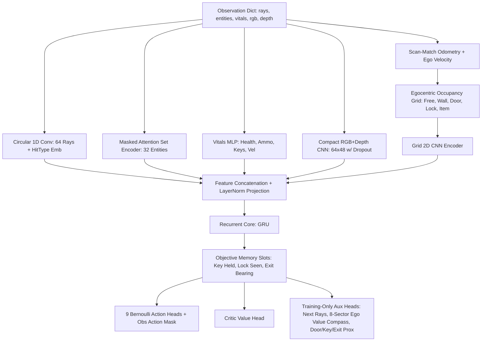
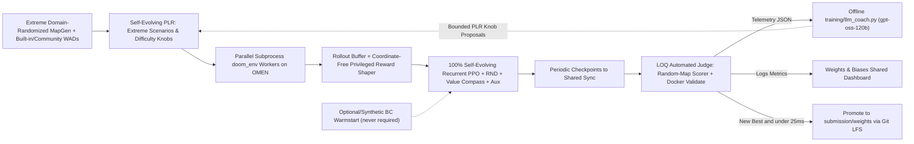
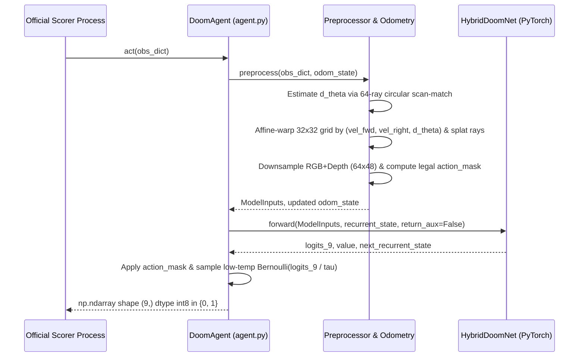
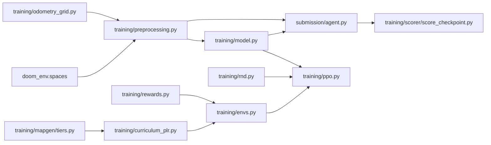

# Detailed System & Neural Design Specification

---

## 1. Architecture Diagrams

### 1.1 Agent Forward & Memory Architecture (`DoomAgent`)

### 1.2 100% Self-Evolving Training, Extreme PLR Curriculum & LOQ Promotion Pipeline

### 1.3 Single `DoomAgent.act(obs)` Step Sequence

### 1.4 Codebase Module Dependency Graph

---

## 2. Component Specifications

### 2.1 Hybrid Sensory Encoders (`training/model.py`)
1. **Ray Circular 1D Encoder (`d_out = 96`):**
   * Input `(B, 8, 64)` (`distance`, `1 - distance`, 6-way `hit_type`).
   * Three `Conv1d` layers with `padding_mode="circular"` (`kernel_size=5, 3, 3`, channels `32 → 64 → 64`, `SiLU`) preserving the 360° wraparound between ray `63` and ray `0`, followed by adaptive pooling `(8 bins × 64)` → linear to `96` dims.
2. **Entity Masked Set Encoder (`d_out = 64`):**
   * Embed `ent_types` (`12 → 16` dims), concat with `ent_feats (5)` → `Linear(21, 64)`.
   * 1-layer Pre-LN Multi-Head Self-Attention (`4` heads, key padding mask `~ent_mask`) + masked mean & max pooling across valid slots (`safe_zero` when `ent_mask.sum() == 0`) → `Linear(128, 64)`.
3. **Vitals + Action Context MLP (`d_out = 48`):**
   * Input `(B, 36)` (normalized vitals, weapon one-hot, key flags, `prev_action`, `use_cooldown`) → `Linear(36, 64) → SiLU → Linear(64, 48)`.
4. **Compact Visual RGB+Depth Encoder (`d_out = 64`):**
   * Input `(B, 4, 48, 64)` → 3-stage depthwise-separable Conv2d (`stride=2` each: `24×32 → 12×16 → 6×8`, channels `16 → 32 → 48`, `SiLU`) → Global Avg+Max Pool → `Linear(96, 64)`.
   * **Modality Dropout:** During training, zero the entire `64`-dim output vector with `p = 0.25` per sequence chunk so the agent still navigates accurately if unseen wall textures shift or if RGB is disabled.
5. **Occupancy Grid CNN (`d_out = 64`):**
   * Input `(B, 6, 32, 32)` → `Conv2d(6, 24, 3, stride=2, pad=1) → SiLU → Conv2d(24, 48, 3, stride=2, pad=1) → SiLU → Conv2d(48, 64, 3, stride=2, pad=1) → Flatten(4×4×64) → Linear(1024, 64)`.
6. **Fusion Layer:** Concatenate `[96 + 64 + 48 + 64 + 64] = 336` → `LayerNorm(336) → Linear(336, 256) → SiLU`.

### 2.2 360° Scan-Matching Odometry & Egocentric Grid (`odometry_grid.py`)
* **Translation:** Each decision covers `FRAME_SKIP = 4` ticks. `dx_ego = vel_forward * 4`, `dy_ego = vel_right * 4` (in map units; divided by `cell_size = 48.0` → grid shift in cells).
* **Yaw Rotation (`Δθ`):**
  * Compute prior shift `k_prior` from `prev_action[TURN_LEFT] - prev_action[TURN_RIGHT]` (`±1` ray bin ≈ `5.625°`).
  * Evaluate candidate integer circular shifts `k ∈ [k_prior - 4, k_prior + 4]` on `rays.distance` (masked where both current and previous rays hit geometry `< 0.98`), adding a small quadratic prior `0.02 * (k - k_prior)^2`.
  * Refine the minimum shift `k*` with 3-point parabolic interpolation to obtain continuous `Δθ = (k* + δ) * (2π / 64)`.
* **Grid Update:**
  * Decay existing grid `grid *= 0.992` (except `locked_door` and `visited` which decay slower at `0.998` so rooms stay remembered across 800+ steps).
  * Warp `grid` into the new ego frame via precomputed 2×3 affine matrix `(dx_cells, dy_cells, -Δθ)` (`cv2.warpAffine` on CPU numpy is `< 0.15 ms` for `(32, 32, 6)`!).
  * Splat current 64 ray endpoints `(r * cos θ_i, r * sin θ_i)` into channels `wall`, `door`, `locked_door`, `item`, `enemy_recent`, and mark `grid[0, 16, 16] = 1.0` (`visited`).

### 2.3 GRU + Objective Memory Slots & Auxiliary Supervision
* **GRU Core:** `nn.GRU(256, 256)`.
* **Objective Memory Slots (`(B, 4, 8)`):**
  * Updated each step via a residual gated write from `gru_out` + explicit 2D rotation of the first two `(cos, sin)` components of each slot by `-Δθ`.
  * Concatenated `[gru_out (256), slots.flatten (32)] = 288` → policy & critic heads.
* **Training-Only Auxiliary Heads (`aux_coef = 0.10`, `compass_coef = 0.15`):**
  1. Predict next-step downsampled 64-bin ray distances (`next_rays: (B, 64)`, `SmoothL1Loss`).
  2. **8-Sector Ego-Directional Value / Advantage Compass (`value_compass: (B, 8)`):** Predicts expected short/medium-horizon discounted reward + sector/grid novelty ("plus points") for each of 8 ego-centric angular sectors (`0..7`, `45°` per sector, `0` = straight ahead, CCW), supervised during PPO from ego-aligned future motion/reward deltas with **zero fixed world XYZ assumptions**.
  3. Predict binary presence + ego `(sin, cos)` bearing to nearest closed/locked door and nearest keycard/exit computed from `privileged_state()` during training. *(Teaches slots to retain locked-door direction after walking away!)*

### 2.4 Policy Heads, Action Masking & Inference Sampling
* **Policy Head:** `Linear(288, 128) → SiLU → Linear(128, 9)` producing independent logits for the 9 buttons.
* **Observation-Legal Action Masking:**
  * `USE` (`idx 7`): When `action[7] == 1` and any front ray (`idx ∈ {61,62,63,0,1,2,3}`) reports `door` or `locked_door` within `distance < 0.15` (`~150` units), set `use_cooldown = 6` steps (~0.7 s). While `use_cooldown > 0`, mask `logits[7] = -1e8`. Also ensures `USE=0` for at least 1 step so button-down edge triggers reliably on next attempt.
  * `ATTACK` (`idx 6`): Mask `logits[6] = -1e8` if `selected_weapon > 1` (not fist/chainsaw) and `selected_weapon_ammo <= 0`.
  * Mutual-exclusion stabilization: If both `MOVE_FORWARD` and `MOVE_BACKWARD` sample `1`, drop whichever had lower probability (or parameterize forward/back/none, strafe L/R/none, turn L/R/none cleanly — **Note:** keeping 9 Bernoulli logits with soft mutual-exclusion penalty in training keeps BC + MultiBinary log-prob math trivial and bug-free).
* **Inference Sampling (`DoomAgent.act`):**
  * Pure greedy (`p > 0.5`) in partially observable FPS environments can get stuck oscillating at symmetric corners. Use **low-temperature seeded Bernoulli sampling** (`probs = sigmoid(logits / 0.85)`, using a deterministic `np.random.default_rng(0)` reset inside `DoomAgent.reset()`), so evaluations are **100% deterministic across repeat runs** yet never freeze in limit cycles.

---

## 3. Dense Training Reward Table (`training/rewards.py`)

Computed solely inside `training/envs.py` using `env.privileged_state()` and `env.sector_polygons()`:

| Signal | Formula / Condition | Default Weight | Purpose |
| :--- | :--- | :--- | :--- |
| **Level Exit** | `info["exit_reached"] == True` | `+15.0 + 3.0 * (rem_ticks / max_ticks)` | Primary leaderboard multiplier + speed bonus. |
| **Unique Sector Visited** | First time player `(x, y)` enters sector `s` (weighted by `clamp(area_s / 512^2, 0.2, 1.5)`) | `+0.40` per sector | Directly mirrors official scorer exploration metric. |
| **Keycard Picked Up** | `sum(keys_now - keys_prev) > 0` | `+4.00` per key | Critical Tier 3 milestone. |
| **Door Opened** | Normal door sector ceiling rises above closed threshold for first time | `+0.60` per door | Rewards `USE` mastery in Tier 2. |
| **Locked Door Unlocked** | Locked door (`door_lock > 0`) ceiling rises for first time | `+5.00` per lock | Bridges key pickup → backtracking → exit. |
| **Enemy Killed** | `kills_now - kills_prev` | `+1.00` per kill | Combat & survival category. |
| **Health / Armor / Ammo Pickup** | `items_now - items_prev` (or useful health/ammo delta) | `+0.15` | Resource sustain in Tier 4. |
| **Damage Taken** | `max(0, dmg_now - dmg_prev)` | `-0.02` per HP | Discourages facetanking projectiles. |
| **Player Death** | `dead == True` | `-4.00` | Penalizes early reckless death. |
| **Door Reversal Bounce** | `action[USE] == 1` causes an opening door sector velocity to reverse downward | `-0.30` | Teaches network itself not to spam `USE`. |
| **Stuck / Wall Scrape** | `MOVE_FORWARD == 1` and `hypot(dx, dy) < 2.0` for `> 8` consecutive steps | `-0.02` / step | Breaks corner wedging fast. |
| **Step Time Cost** | Every step | `-0.002` | Gentle urgency without inducing suicide. |

*(Intrinsic RND + Grid-Cell novelty reward is normalized by running std and added with `rnd_coef = 0.05` + `grid_novelty_coef = 0.03`.)*

---

## 4. Single-Thread CPU Latency Budget (`torch.set_num_threads(1)`)

| Operation inside `DoomAgent.act(obs)` | Estimated CPU Time (1 Thread) |
| :--- | :--- |
| `cv2.resize` (`160×120 → 64×48` RGB + Depth) + Vitals/Ray array packing | `~0.4 ms` |
| 64-ray circular scan-matching (`9` integer shifts) + `cv2.warpAffine` `(32,32,6)` | `~0.5 ms` |
| Hybrid Encoders (1D Ray Conv + 32-slot Attention + `64×48` Depthwise CNN + Grid CNN) | `~3.8 ms` |
| GRU `(256)` + Objective Slots `(4×8)` + Action Head `(9)` | `~0.8 ms` |
| Masking + RNG sampling + NumPy `int8` conversion | `~0.2 ms` |
| **Total Expected `act()` Time (CPU 1-Thread)** | **`~5.7 ms`** *(~1.5 ms on RTX 3090 CUDA)* — **7× faster than the `40 ms` cap!** |

---

## 5. Clean Fallback Design

If scan-matching odometry shows drift or slows down training before **H14**:
* Set `model_config["use_grid"] = False` in config.
* `preprocess()` skips `warpAffine` and passes a constant zero tensor `(B, 6, 32, 32)` (cost: `0 ms`).
* `GRU(256)` + `Objective Memory Slots` (driven by turn action integration `k_prior`) still retain keycard/door memory and pass `validate.py --docker` with zero interface changes.
